<div align="center">

  <h1>🏛️ LexGuard</h1>
  <h3>AI contract review for Indian law</h3>

  <p align="center">
    <i>Upload an employment, freelance or vendor contract. LexGuard splits it into clauses, rates how risky each one is for the person signing, explains it in plain language, cites the Indian statute it touches, and drafts a fairer rewrite.</i>
  </p>

  <p align="center">
    <a href="https://github.com/Aditya2514/LexGuard/actions/workflows/tests.yml"></a>
    <a href="LICENSE"></a>
    <a href="#-tech-stack-matrix"></a>
    <a href="#-tech-stack-matrix"></a>
    <a href="#️-rag-statutory-grounding-engine"></a>
  </p>

  <br />

  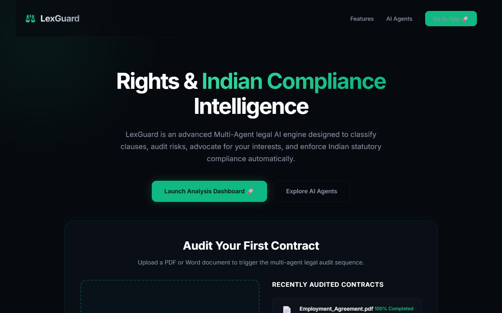

</div>

<br />

---

## 🧗 What Was Hard

A contract reviewer that is right most of the time is easy to demo and hard to trust. Most of the work went into the parts around the LLM:

- **LLMs under-rate polished traps.** A predatory clause written in calm legal language often comes back LOW. After the risk analyst and an adversarial second pass, a deterministic detector (38 hand-written trap patterns in `classifierService.js`) can force an escalation, and a reflection loop makes the model explain the trap it missed.
- **Fitting in 512 MB.** The first host capped RAM at 512 MB. The backend runs with a 380 MB V8 heap limit, drops local embedding models after inactivity in `LOW_MEMORY_MODE`, and forces garbage collection after each job.
- **Providers fail mid-document.** Hugging Face serverless returns 402 when free credit runs out. The AI client cascades across Gemini, Groq, Hugging Face and local Ollama instead of failing the job.
- **Extracted text is messy.** PDFs glue section numbers onto the previous sentence (`courts.16. GOVERNING LAW`) and lose line breaks. A two-pass chunker repairs that before any model sees it, and parsing falls back from LlamaParse to `pdf-parse` to Tesseract OCR for scans.
- **Clause IDs drift.** Letting the LLM echo clause IDs back attached results to the wrong clause, so clauses are keyed by their position in the document instead.

---

## 📌 Table of Contents

- [🧗 What Was Hard](#-what-was-hard)
- [💡 Overview](#-overview)
- [✨ Key Capabilities & Features](#-key-capabilities--features)
- [🖼️ Product Tour & UI Showcase](#️-product-tour--ui-showcase)
- [🏗️ System Architecture](#️-system-architecture)
- [🤖 The 6-Agent AI Orchestration Engine](#-the-6-agent-ai-orchestration-engine)
- [🛡️ Commercial Asymmetry Engine & Deterministic Safety Net](#️-commercial-asymmetry-engine--deterministic-safety-net)
- [⚙️ RAG Statutory Grounding Engine](#️-rag-statutory-grounding-engine)
- [📏 Evaluation](#-evaluation)
- [💻 Tech Stack Matrix](#-tech-stack-matrix)
- [🚀 Quick Start & Installation](#-quick-start--installation)
- [📡 API Endpoints Reference](#-api-endpoints-reference)
- [🔐 Security & Production Hardening](#-security--production-hardening)

---

## 💡 Overview

**LexGuard** is a full-stack app that parses, analyzes and audits agreements under Indian law. It is built for employees, freelancers and founders who sign contracts without a lawyer, and it turns legalese into plain language while surfacing one-sided clauses.

A single LLM call misses subtle traps, cites statutes that don't exist, and falls over on long documents. LexGuard splits the job into a **sequential agent pipeline**, grounds statutory citations with **retrieval over 7,556+ Indian law sections** in MongoDB Atlas Vector Search, and backs the LLM with a **deterministic safety net** of 38 hand-written trap patterns.

---

## ✨ Key Capabilities & Features

<table>
  <tr>
    <td width="50%">
      <h3>📄 3-Tier Parsing Fallback</h3>
      <p>Seamless document processing supporting PDF and DOCX files. Implements an automatic 3-tier fallback hierarchy (<b>LlamaParse</b> cloud vision → <b><code>pdf-parse</code></b> local stream → <b>Tesseract OCR</b>) to handle complex, scanned, or image-heavy agreements.</p>
    </td>
    <td width="50%">
      <h3>🤖 6-Agent AI Pipeline</h3>
      <p>Orchestrates specialized, isolated AI agents: Global PreFlight Context Extractor, Clause Classifier, Commercial Risk Analyst, Adversarial Judge, Plain-Language Advocate, and Geo-RAG Compliance Engine.</p>
    </td>
  </tr>
  <tr>
    <td width="50%">
      <h3>🛡️ Commercial Asymmetry Engine</h3>
      <p>Replaces basic keyword scanning with an advanced legal risk layer targeting unconscionable clauses: unilateral jurisdiction, non-solicit traps, IP pre-assignment, predatory equity clawbacks, and wage forfeiture.</p>
    </td>
    <td width="50%">
      <h3>🧠 MongoDB Atlas Vector RAG</h3>
      <p>Performs 384-dimensional <code>$vectorSearch</code> queries directly at the database layer against <b>7,556+ statutory nodes</b> (Contract Act 1872, DPDP Act 2023, Copyright Act, etc.) filtered by legal domain and jurisdiction, keeping matches at <code>0.70</code> similarity or above and tagging those under <code>0.80</code> as lower confidence.</p>
    </td>
  </tr>
  <tr>
    <td width="50%">
      <h3>💬 Interactive Contract Chat</h3>
      <p>Context-aware conversational assistant allows users to ask arbitrary legal questions regarding obligations, termination windows, non-compete boundaries, and IP ownership.</p>
    </td>
    <td width="50%">
      <h3>💳 Production SaaS & Razorpay</h3>
      <p>Full auth & quota system, rolling 30-day usage resets, tiered plans (Free, Pro, Enterprise), native GridFS memory streaming, Upstash Redis job queue, and Razorpay payment integration.</p>
    </td>
  </tr>
</table>

---

## 🖼️ Product Tour & UI Showcase

### 1. Executive Intelligence Dashboard
> *Monitor uploaded contracts, overall risk distribution, usage quotas, and recent document status at a glance.*

<div align="center">
  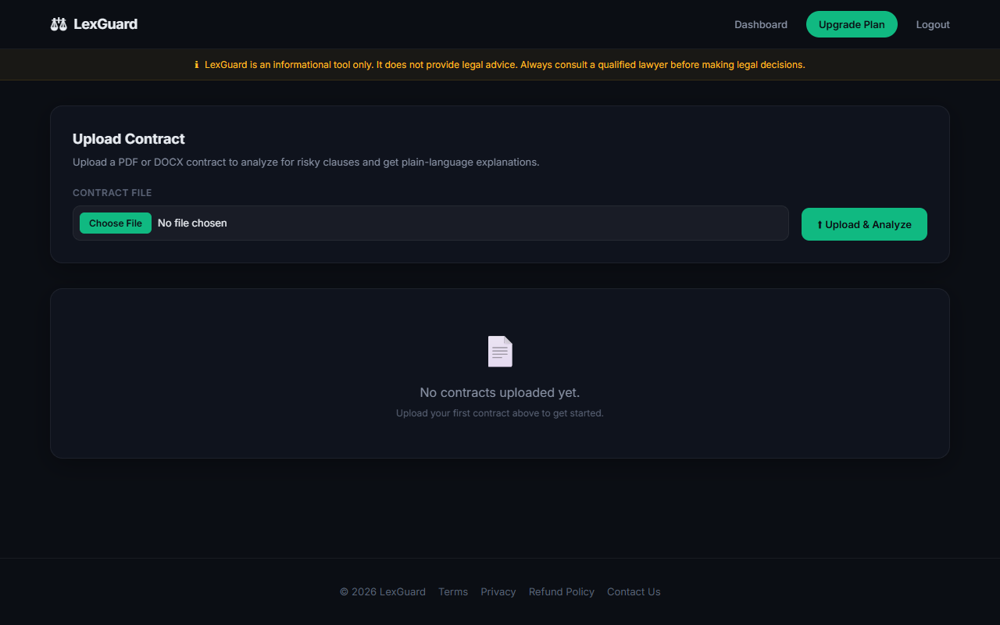
</div>

<br />

### 2. Multi-Agent Async Pipeline Processing
> *Real-time visualization as document clauses progress through PreFlight extraction, Agent classification, Risk analysis, and Statutory compliance checking.*

<div align="center">
  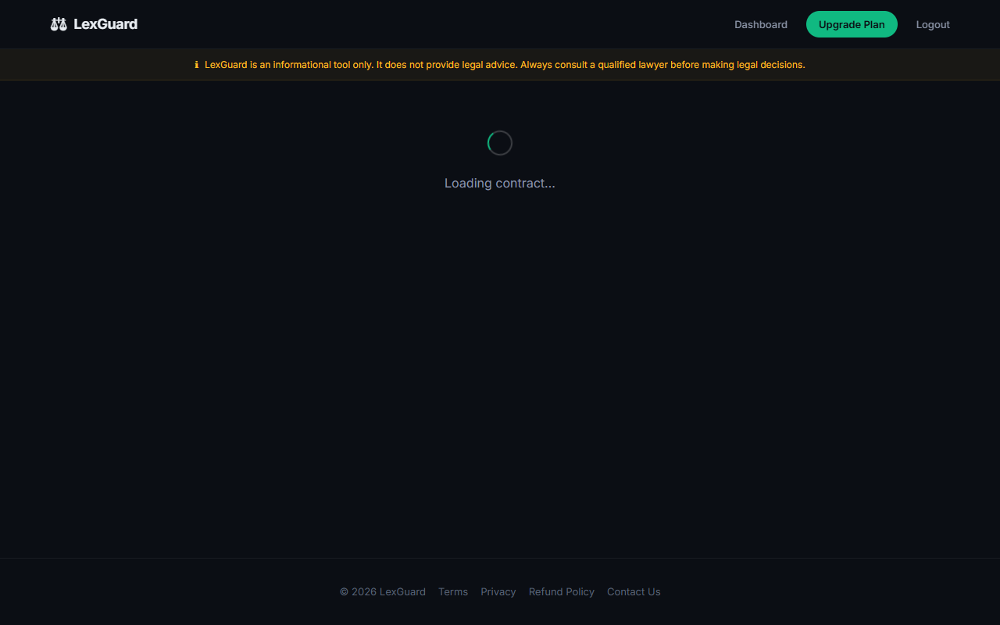
</div>

<br />

### 3. Comprehensive Contract Analysis & Clause Breakdown
> *Granular clause rating (Low, Medium, High, Critical), plain-language explanations, worst-case scenarios, negotiation advice, statutory citations, and one-click suggested rewrites.*

<div align="center">
  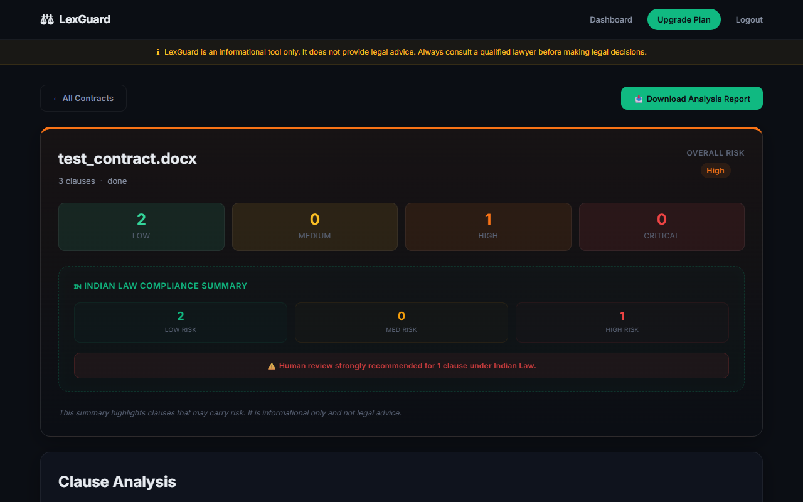
</div>

<br />

### 4. SaaS Tier Management & Razorpay Checkout
> *Flexible subscription tiers (Free / Pro / Enterprise) backed by Razorpay payments for instant quota upgrades.*

<div align="center">
  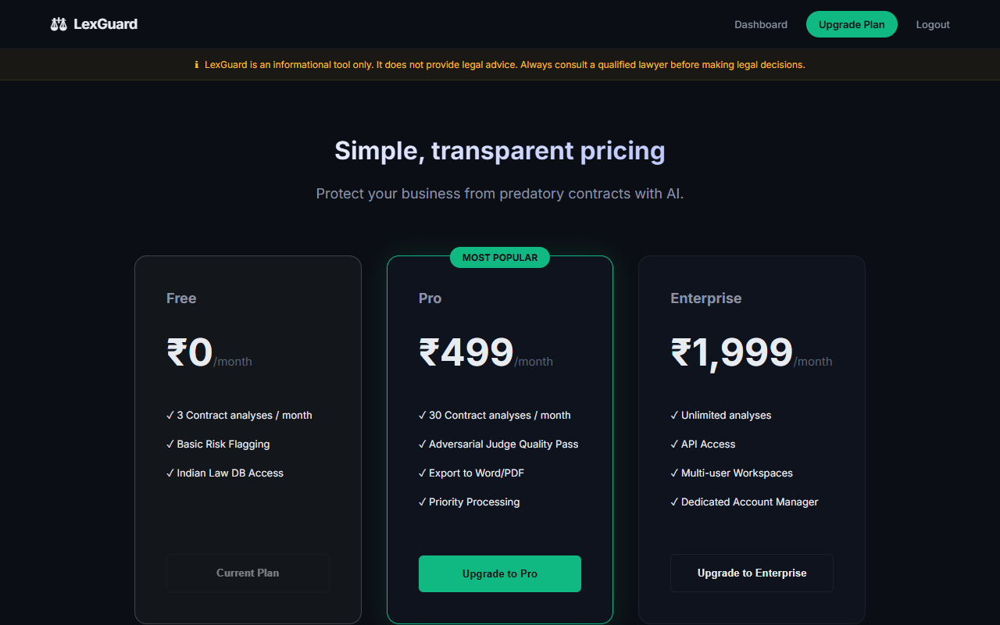
  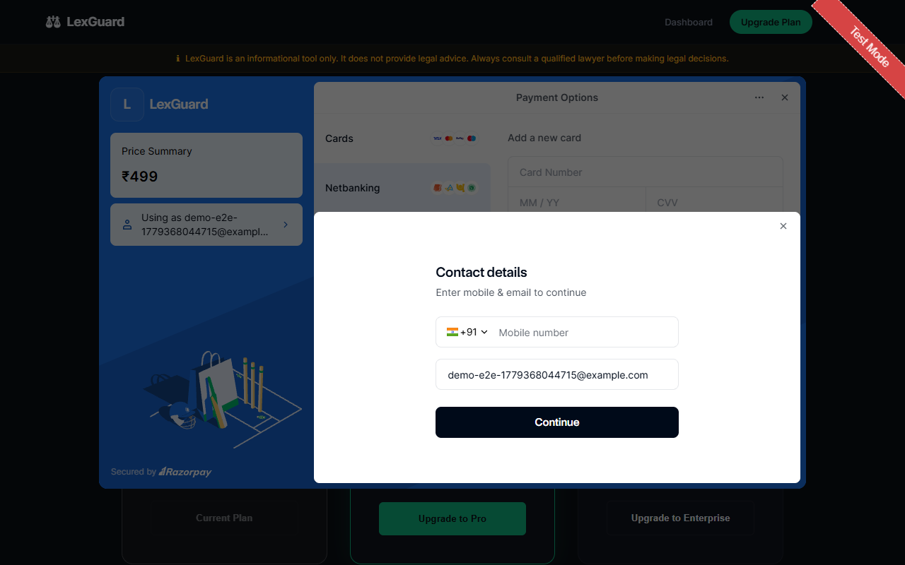
</div>

<br />

### 5. Seamless Onboarding & User Authentication
> *Secure JWT-based user authentication, key management, and session state persistence.*

<div align="center">
  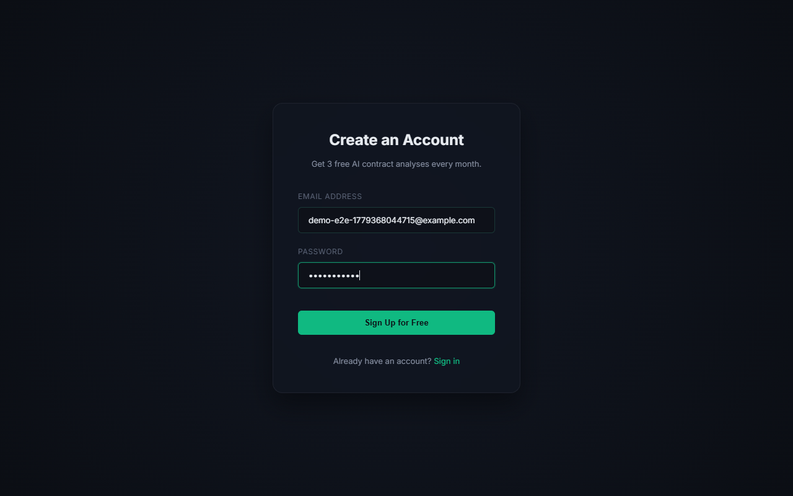
</div>

---

## 🏗️ System Architecture

LexGuard follows a decoupled, asynchronous micro-architecture engineered for high throughput, zero asynchronous race conditions, and cloud resilience.

<div align="center">
  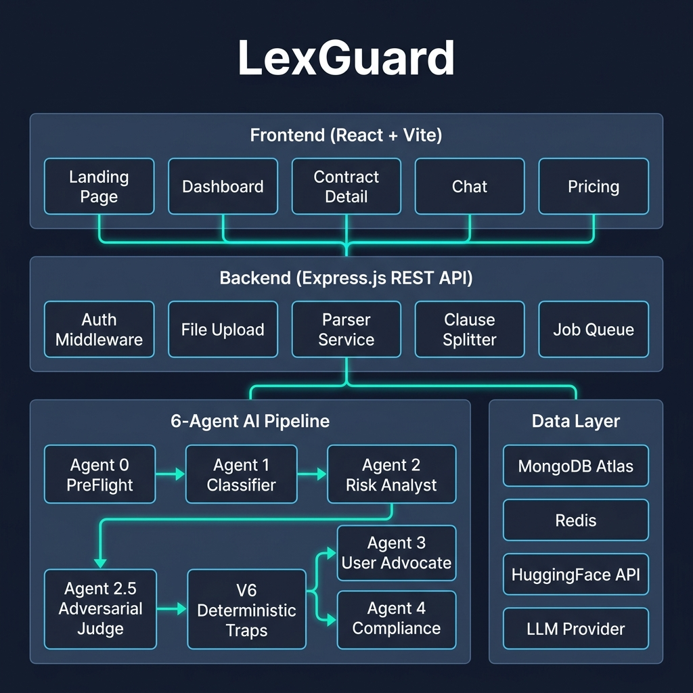
</div>

### System Flow (Mermaid Visual)

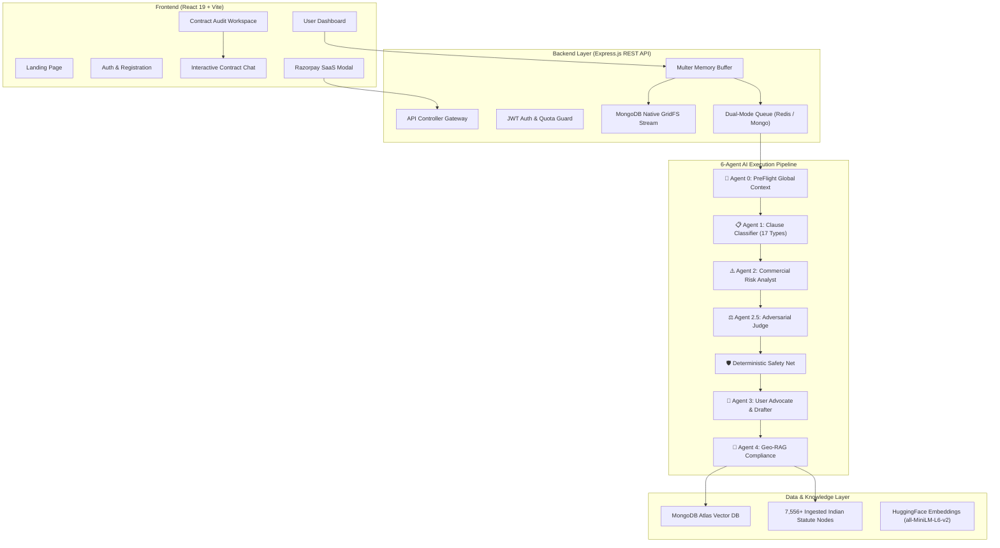

---

## 🤖 The 6-Agent AI Orchestration Engine

LexGuard executes a multi-stage sequential agent pipeline. Each agent operates with isolated system prompts, deterministic JSON schemas, custom temperature settings, and targeted roles:

<div align="center">
  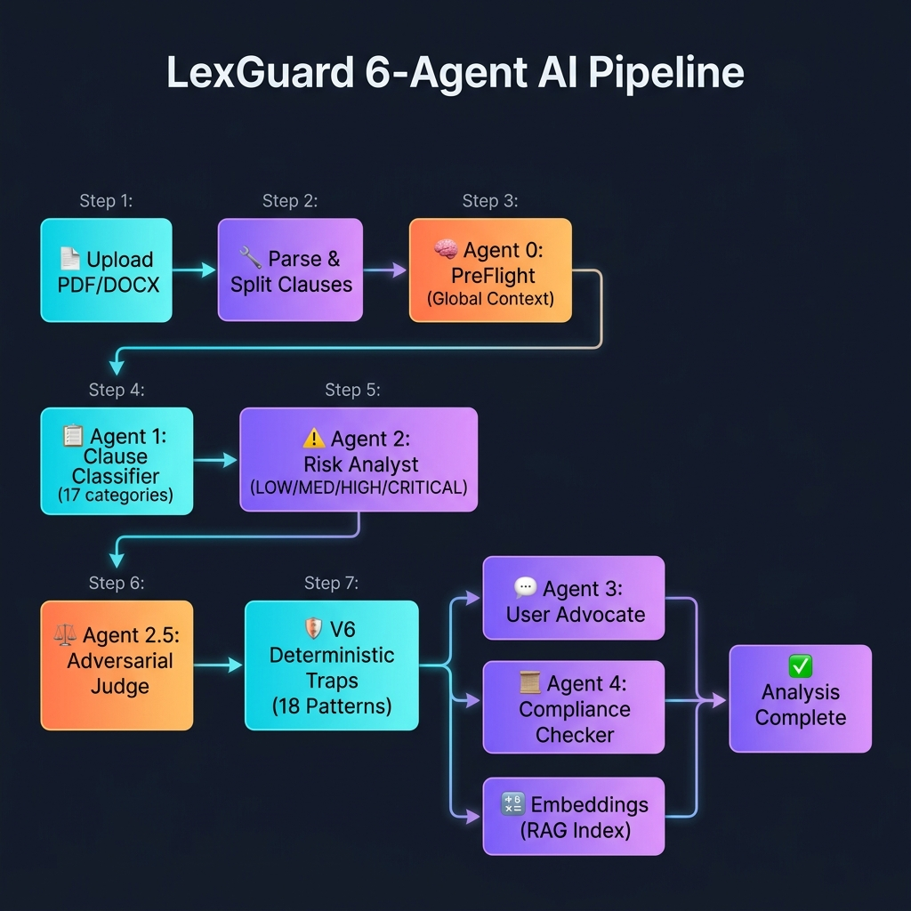
</div>

<br />

| Agent | Name | Role & Responsibility | Temperature |
| :--- | :--- | :--- | :--- |
| **Agent 0** | **PreFlight Engine** | Scans document header (first 12K chars) to extract governing law, parties, designations, and global definitions. | `0.1` |
| **Agent 1** | **Clause Extractor & Classifier** | Maps parsed text into discrete clauses and categorizes them across 17 legal types (Non-Compete, IP Assignment, Indemnity, Jurisdiction, etc.). | `0.1` |
| **Agent 2** | **Risk Analyst (Asymmetry Engine)** | Performs 4-tier risk assessment (`LOW`, `MEDIUM`, `HIGH`, `CRITICAL`), calculating asymmetric leverage and potential liability. | `0.2` |
| **Agent 2.5** | **Adversarial Judge** | Cross-examines Agent 2 outputs from a hostile employer/vendor perspective to eliminate false positives and false negatives. | `0.1` |
| **Safety net** | **Deterministic Trap Detector** | Scans clause text against 38 hand-written trap patterns and escalates the rating if the AI missed or under-rated a trap. | `Deterministic` |
| **Agent 3** | **User Advocate** | Translates legalese into plain language, details worst-case scenarios, provides negotiation advice, and drafts balanced rewrites. | `0.3` |
| **Agent 4** | **Geo-RAG Statutory Compliance** | Queries Atlas Vector Search for statutory sections, auditing compliance against Indian laws (Contract Act, DPDP, IT Act, etc.). | `0.1` |
| **Agent 5** | **Interactive Contract Chat** | Context-aware LLM agent allowing instant interactive Q&A over the entire contract state. | `0.4` |

---

## 🛡️ Commercial Asymmetry Engine & Deterministic Safety Net

LLM risk scanners often miss traps disguised as standard boilerplate. LexGuard runs a **deterministic safety net** after the LLM: if a known trap pattern matches, the clause cannot be rated below it.

<div align="center">
  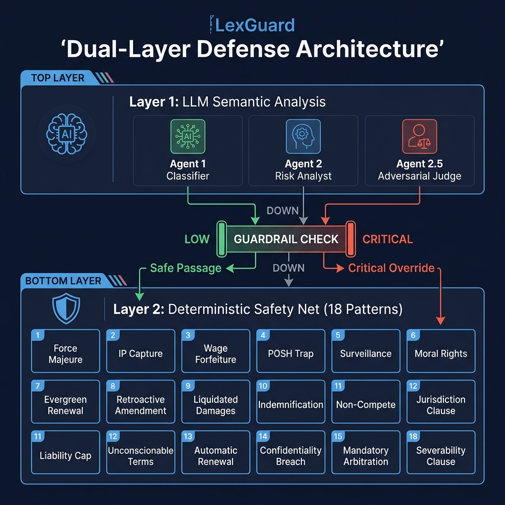
</div>

<br />

### Key Traps Detected & Blocked Automatically

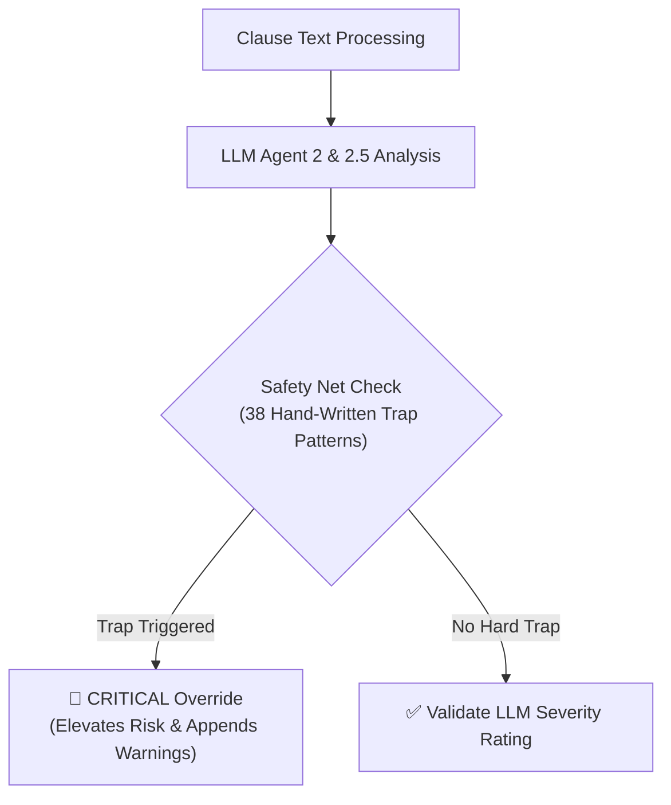

- **Unilateral Force Majeure**: Disproportionate termination rights during business disruptions.
- **Pre-Existing IP Capture**: Broad employer claims on personal, pre-existing employee inventions.
- **Punitive Wage Forfeiture**: Illegal salary deductions or withholding upon notice period dispute.
- **Global Non-Solicit Scope**: Unenforceable, overly restrictive worldwide client/employee bans.
- **POSH Gag Orders**: Clauses preventing mandatory statutory reporting under Indian POSH law.
- **Excessive Liquidated Damages**: Unreasonable financial penalties disproportional to actual loss.
- **Evergreen Auto-Renewal**: Hidden recurring commitments without explicit opt-in triggers.
- **Ghost Jurisdiction / Tax Havens**: Forced foreign arbitration forums outside Indian court authority.

---

## ⚙️ RAG Statutory Grounding Engine

LexGuard strictly grounds its statutory compliance analysis using Retrieval-Augmented Generation (RAG).

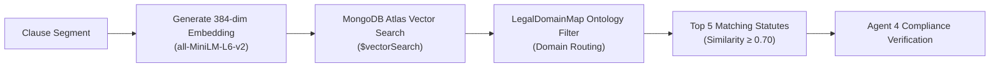

### Statutory Database Highlights
- **7,556+ Ingested Statute Nodes** with pre-computed 384-dimensional vector embeddings.
- **Ingested Acts Include**:
  - *Indian Contract Act, 1872*
  - *Digital Personal Data Protection (DPDP) Act, 2023*
  - *Copyright Act, 1957*
  - *Industrial Disputes Act, 1947*
  - *Information Technology (IT) Act, 2000*
  - *Specific Relief Act, 1963*
  - *POSH Act, 2013*

---

## 📏 Evaluation

These numbers come from the reports committed in [`backend/benchmark/`](backend/benchmark) (May 2026 runs). Each case is a single clause with an expected clause type and risk tier.

| Suite | Cases | Clause type correct | Risk tier correct | Risky clauses rated too low |
| :--- | :---: | :---: | :---: | :---: |
| Master calibration | 30 | 28 (93%) | 21 (70%) | 0 |
| Adversarial ("heavy") | 10 | 9 (90%) | 10 (100%) | 0 |
| Ultra | 5 | 5 | 4 | 0 |

What these numbers do and don't say:

- **It errs toward over-flagging.** All 9 risk misses in the master suite rated a clause *more* severe than expected (HIGH → CRITICAL, or a fair safe-harbour clause → CRITICAL). It never under-rated a risky clause in these runs. That is the right direction to fail for a tool protecting the signer, but it means noise on fair contracts.
- **I wrote the cases.** The same person wrote the test clauses and the trap patterns, so these suites catch regressions; they do not show how well LexGuard generalises to contracts it has never seen. A held-out set of real contracts is the next step.
- **Benchmarks need live services.** `npm run benchmark` calls the LLM providers and MongoDB. The offline unit suite (`npm test`, runs in CI on every push) covers the deterministic layer: text cleaning, clause chunking, fact extraction and the cross-clause contradiction rules.

---

## 💻 Tech Stack Matrix

### Frontend Architecture
- **Framework**: React 19 + Vite
- **State & Data Fetching**: `@tanstack/react-query` v5
- **Routing**: React Router v7 (`react-router-dom`)
- **UI & Visualization**: Recharts v3, `diff` (visual rewrites), `html2pdf.js`, `react-joyride`
- **Design System**: Modern Vanilla CSS with dark mode tokens & glassmorphic accents

### Backend & AI Infrastructure
- **Runtime**: Node.js (v18+) & Express.js
- **Database**: MongoDB Atlas (`Mongoose` v8) with `$vectorSearch` and native GridFS streaming
- **Caching & Queue**: Upstash Redis (`redis` v5) with active MongoDB fallback polling
- **AI & LLM Services**: HuggingFace Inference API (`meta-llama`), `@google/generative-ai`
- **Vector Embeddings**: `@xenova/transformers` (`sentence-transformers/all-MiniLM-L6-v2`)
- **Document Extractors**: LlamaParse Cloud API, `pdf-parse`, `tesseract.js`, `mammoth` (DOCX)
- **Security & SaaS**: `jsonwebtoken`, `bcryptjs`, `helmet`, `express-rate-limit`, `razorpay`

---

## 🚀 Quick Start & Installation

### Prerequisites
- **Node.js**: `v18.0.0` or higher
- **npm**: `v9.0.0` or higher
- **MongoDB Atlas**: Cluster with Vector Search enabled
- **HuggingFace API Key** or **Google Gemini API Key**

### 1. Clone the Repository
```bash
git clone https://github.com/Aditya2514/LexGuard.git
cd LexGuard
```

### 2. Backend Setup
```bash
cd backend
npm install
```

Copy `backend/.env.example` to `backend/.env` and fill in at least `MONGODB_URI`, `JWT_SECRET` and one LLM key (`GEMINI_API_KEY`, `GROQ_API_KEY` or `HUGGINGFACE_API_KEY`). Redis, Pinecone, Neo4j and Razorpay are optional.

```bash
cp .env.example .env
```

### 3. Seed Knowledge Base (Statute Nodes)
```bash
node seedCaseLaw.js
```

### 4. Start Backend Server
```bash
# Development mode
npm run dev

# Production mode
npm start
```

### 5. Frontend Setup
In a new terminal window:
```bash
cd frontend
npm install
npm run dev
```
Open your browser at `http://localhost:5173`.

### 6. Run the Tests
```bash
cd backend
npm test            # offline unit suite, no keys needed
npm run benchmark   # LLM benchmark suites, needs .env
```

---

## 📡 API Endpoints Reference

| Category | Method | Endpoint | Description | Auth Required |
| :--- | :--- | :--- | :--- | :---: |
| **Auth** | `POST` | `/api/auth/register` | Register new user account | ❌ |
| **Auth** | `POST` | `/api/auth/login` | User authentication & JWT generation | ❌ |
| **Auth** | `GET` | `/api/auth/me` | Fetch current user profile & quota | ✅ |
| **Contracts**| `POST` | `/api/contracts/upload` | Upload PDF/DOCX contract & initiate queue | ✅ |
| **Contracts**| `GET` | `/api/contracts` | List all user uploaded contracts | ✅ |
| **Contracts**| `GET` | `/api/contracts/:id` | Fetch contract analysis detail & progress | ✅ |
| **Clauses** | `GET` | `/api/contracts/:id/clauses` | Retrieve parsed clause segments with agent outputs | ✅ |
| **Chat** | `POST` | `/api/chat/:contractId` | Ask interactive legal questions to Agent 5 | ✅ |
| **Payments** | `POST` | `/api/payments/create-order`| Generate Razorpay subscription order | ✅ |
| **Payments** | `POST` | `/api/payments/verify` | Verify Razorpay payment signature & update plan | ✅ |

---

## 🔐 Security & Production Hardening

- **Multipart Direct Memory Streaming**: Uses Multer memory buffers directly into MongoDB GridFS streams, eliminating temporary disk storage and BSON size limitations.
- **Strict Key Hashing**: Password storage secured with `bcryptjs` using salt rounds = 10.
- **HTTP Hardening**: Configured with `helmet` for header security and `express-rate-limit` to prevent API abuse.
- **Deterministic ID Synchronization**: Eliminates asynchronous data race conditions by indexing clauses through numeric sequence arrays rather than echoing AI-generated string IDs.

---

<div align="center">
  <br />
  <p>Released under the <a href="LICENSE">MIT License</a>. LexGuard explains contracts; it is not legal advice.</p>
</div>
